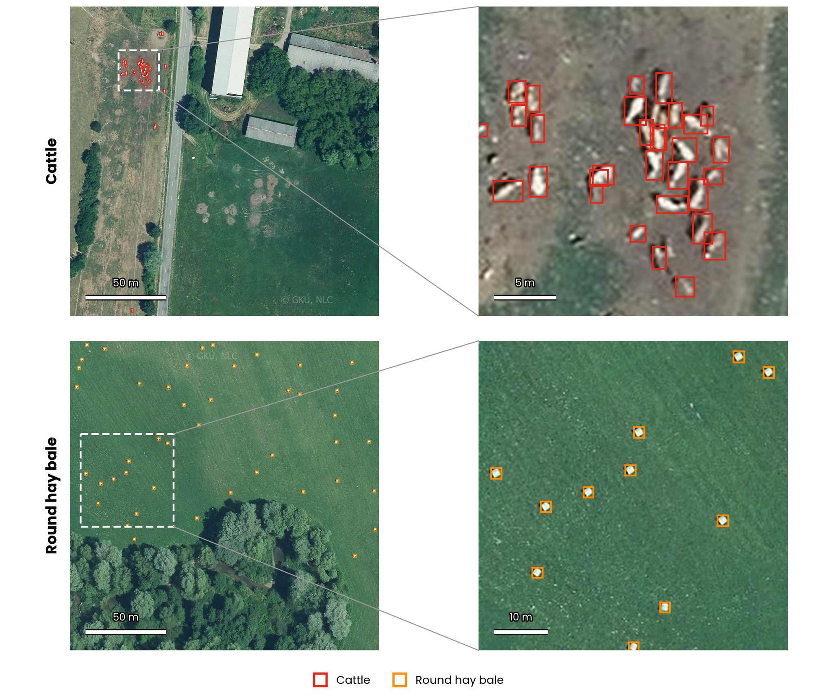
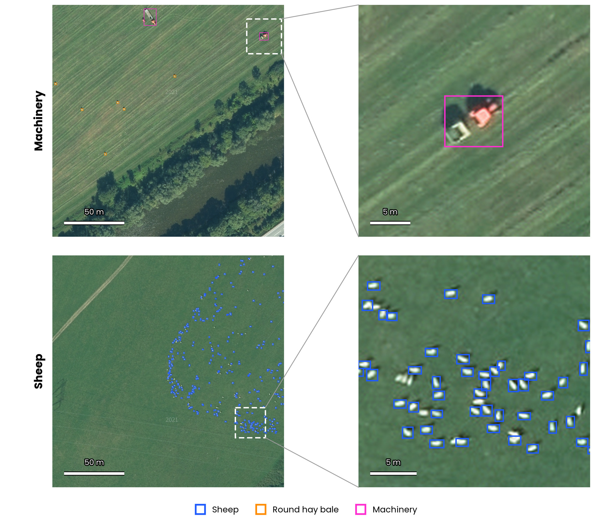
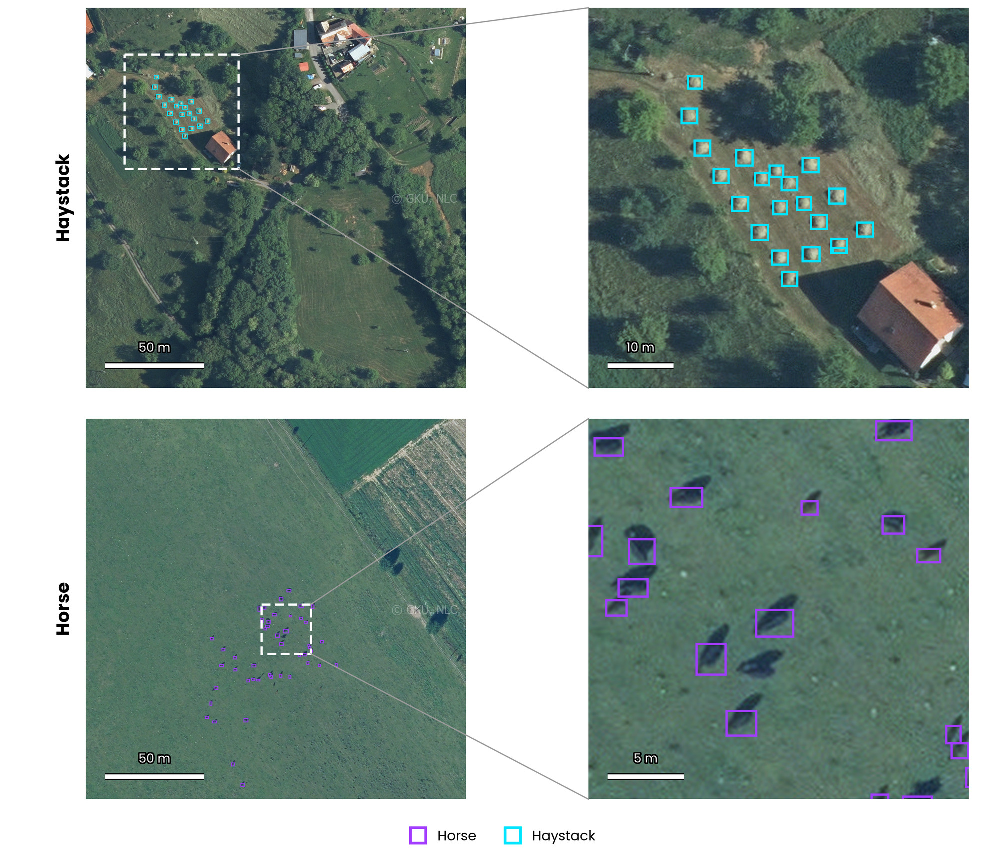

<h1 align="center">
  <br>
  
  <br>
  Grassland Management from Aerial Imagery (GMAI)
  <br>
</h1>

<p align="center">

  <a href="https://colab.research.google.com/github/HudcovicMarcel/grassland-management-from-aerial-imagery/blob/main/GMAI.ipynb">
    
  </a>
  
  <a href="https://doi.org/10.5281/zenodo.24108529">
    
  </a>

  <a href="https://www.grass4b.com/_sub/">
  
</a>

</p>


## Description

This repository serves as **supplementary material** and **release** of the code and dataset for the paper:

*Monitoring grassland management practices from nationwide aerial imagery using deep learning*

**Preprint: http://dx.doi.org/10.2139/ssrn.7384227 <a href="http://dx.doi.org/10.2139/ssrn.7384227">**

The repository and dataset were updated after the revision of the paper submitted to *Ecological Informatics*.

Our study trains the **YOLO11** model (Jocher & Qiu, 2024) to detect objects representing grassland management practices in aerial imagery from the third cycle of the orthophotomosaic from the western part of **Slovak Republic** (2023), with a ground sampling distance of **15 cm**.

## Dataset content

The dataset consists of **929 manually labeled model tiles** (1280x1280px, RGB, 15 cm) derived from **373 source tiles** (2.5 × 2 km) of the 2023 orthophotomosaic, with **24,318 bounding boxes**. The tiles were split **by source tile** into Train (~60%), Validation (~20%) and Test (~20%) subsets, so that overlapping tiles never occur in different subsets. Augmentation (flips and 90° rotations) was applied to the **training subset only**.

**Count of labels (bounding boxes) for each class:**
| Class           | Train (original) | Train (augmented copies) | Val   | Test  |
|-----------------|------------------|--------------------------|-------|-------|
| Cattle          | 5,131            | 5,263                    | 1,708 | 1,708 |
| Sheep           | 4,564            | 4,948                    | 1,550 | 1,536 |
| Horse           | 737              | 5,159                    | 245   | 245   |
| Round hay bale  | 3,349            | 3,499                    | 1,117 | 1,116 |
| Square hay bale | 586              | 4,102                    | 207   | 186   |
| Haystack        | 135              | 945                      | 44    | 45    |
| Machinery       | 65               | 455                      | 22    | 22    |
| **Tiles**       | 557              | 1,811                    | 186   | 186   |

> **Note:**  
> - The applied augmentation technique is described in the paper and implemented in the notebook (step 1.5).  
> - **Original** - labels on the original tiles.  
> - **Augmented copies** - labels on the rotated and flipped copies, which exist in the training subset only.

## Data

Hosted on **Zenodo**:

```bash

10.5281/zenodo.24108529/
│
├── dataset.zip/               # Images and labels used for YOLO11 training, validation and testing
│   └── dataset/
│       ├── train/             # Training subset ≈ 60% of the tiles, with augmented copies
│       │   ├── images/ 
│       │   └── labels/ 
│       ├── val/               # Validation subset ≈ 20%, original tiles only
│       │   ├── images/
│       │   └── labels/ 
│       ├── test/              # Test subset ≈ 20%, original tiles only
│       │   ├── images/
│       │   └── labels/ 
│       └── dataset.yaml       # Configuration file specifying dataset paths, class names, and train/val/test splits for YOLO training
│      
├── YOLO11x_GMAI.pt            # PyTorch checkpoint of the final YOLO11x model trained on the GMAI dataset
│
├── GMAI_OD_results.gpkg       # Results across the three Slovak orthophoto cycles (2017–2023)
│
└── demo_data.zip              # Contains exemplary data for running the workflow in the Google Colab notebook (for demonstration and replication)
```
> **Note:**  
> In *dataset.zip*, model tiles are named `<source tile>_<tile id>`. Files with a suffix after the numeric tile id are augmented copies: `_flipped` (rotated by 180°), `_flipped_hor`, `_flipped_ver`, `_rotate_90`, `_rotate_90_ccw`, `_rotate_90_ccw_flip_hor` and `_rotate_90_ccw_flip_ver`.

## Model performance

The final model, **YOLO11x** (COCO-pretrained, SGD, batch size 16), was selected on the validation subset and evaluated once on the test subset:

| Precision | Recall | F1    | mAP50 | mAP50-95 |
|-----------|--------|-------|-------|----------|
| 0.836     | 0.770  | 0.794 | 0.842 | 0.561    |

On independent validation samples from the first and second cycles, resized to 15 cm, the model reached a mAP50 of 0.694 and 0.778, respectively.

## Usage

A full end-to-end workflow is available in the accompanying Google Colab notebook. It provides step-by-step code, methodological explanations, and the ability to replicate the workflow using included demo data.

## Results

Results of our study are provided as a GeoPackage file hosted on Zenodo.  
Each polygon in the dataset contains a set of attributes describing:

- **Predicted class** (class_id/class_name : 0/Cattle, 1/Haybale_round, 2/Haybale_square, 3/Haystack, 4/Horse, 5/Machinery, 6/Sheep)
- **Type of management practice** (mowing/grazing)
- **Prediction confidence** of the YOLO11x model (confidence ≥ 0.3)
- **Acquisition date** of the orthophoto from which the object was detected (Datum)

All geometries are stored in the **S-JTSK / Krovak East North (EPSG:5514)** coordinate reference system.

**Examples of detections** (left: 192 m area with all detections; right: detail of the dashed window)

*Cattle and round hay bales, first cycle imagery*



*Machinery and sheep, second cycle imagery*



*Haystacks and horses, third cycle imagery (2023)*



**Predictions Across Slovak Orthophotomosaic Cycles**

| Class               | 2017   | 2018    | 2019    | 2020   | 2021    | 2022    | 2023   |
|---------------------|--------|---------|---------|--------|---------|---------|--------|
| **Cattle**          | 7,023  | 25,147  | 31,048  | 6,422  | 36,769  | 31,105  | 10,832 |
| **Sheep**           | 5,835  | 70,764  | 121,375 | 7,175  | 110,235 | 78,976  | 6,780  |
| **Horse**           | 1,051  | 1,508   | 428     | 896    | 1,447   | 953     | 1,962  |
| **Round hay bale**  | 3,279  | 33,080  | 44,277  | 9,143  | 62,948  | 34,255  | 8,695  |
| **Square hay bale** | 170    | 314     | 1,900   | 104    | 844     | 174     | 157    |
| **Haystack**        | 94     | 307     | 117     | 81     | 753     | 79      | 379    |
| **Machinery**       | 226    | 308     | 383     | 418    | 757     | 276     | 357    |
| **Total**           | 17,678 | 131,428 | 199,528 | 24,239 | 213,753 | 145,818 | 29,162 |

> **Note:**  
> The file includes detections on grassland plots above 1200 m a.s.l. The analyses in the paper exclude these plots, because false-positive sheep detections on rocky outcrops dominate there.

## Credits

- Aerial imagery is under **CC BY Creative Commons Attribution (GKÚ Bratislava, NLC) 4.0**.  
- **YOLO11** model by **Ultralytics** (Jocher & Qiu, 2024).  
  Citation: Jocher, G. & Qiu, J. (2024). *Ultralytics YOLO11*, version 11.0.0. Available at: [https://github.com/ultralytics/ultralytics](https://github.com/ultralytics/ultralytics). License: AGPL-3.0.
- README template adapted from **[Electron Markdownify](https://github.com/amitmerchant1990/electron-markdownify)** by Amit Merchant.


## License

**Creative Commons Attribution 4.0 International (CC BY 4.0)**

You are free to share, adapt, and build upon the materials for any purpose, provided appropriate credit is given.

If you use the GMAI dataset, please cite:
Hudcovič, M. (2026). Grassland Management from Aerial Imagery (GMAI) [Data set]. Zenodo. https://doi.org/10.5281/zenodo.24108529
